[简体中文](README.md) | English

# TaskbarPopup

A Windows 10/11 taskbar enhancement: when a window is maximized, the taskbar hides and the window fills the whole screen. Hold the Win key and a liquid-glass mini taskbar pops up from the bottom of the screen. Single exe, no runtime to install.

> The interface comes in English and Chinese. It follows your Windows display language; change it under Settings → Appearance → Language.

Demo video: [YouTube](https://youtu.be/nTGIbGz5Qlw)

## Features

### Maximize means full screen

Maximize a window and the taskbar slides away while the window fills the screen. Restore, minimize or close it and the taskbar slides back, with your desktop icons right where they were.

You can also turn on "Always hide taskbar" in Settings (off by default): the taskbar stays hidden even with no maximized window, and touching the screen edge won't bring it up. Hold Win when you need it.

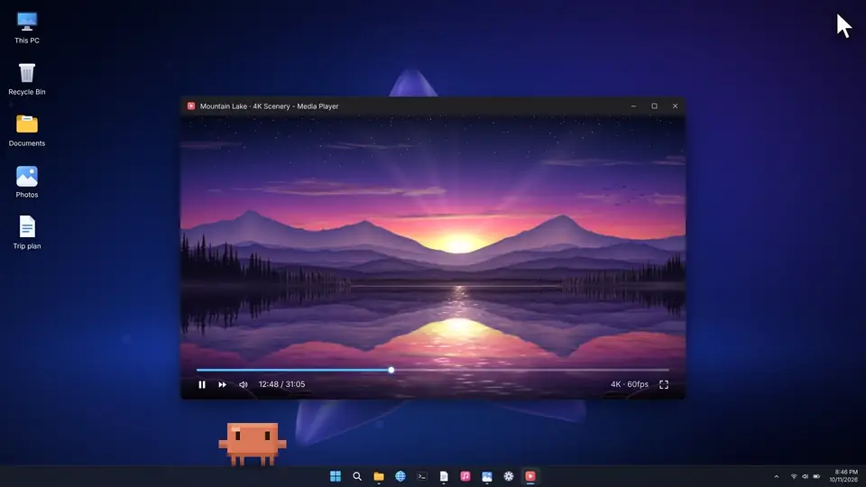

### Per-app rule

Right-click an app in the mini taskbar and tick "Don't hide taskbar when maximized": the taskbar stays when that app is maximized. If you turn off "Hide taskbar when maximized or fullscreen" in Settings, the item becomes "Hide taskbar when maximized" and only the ticked apps hide the taskbar.

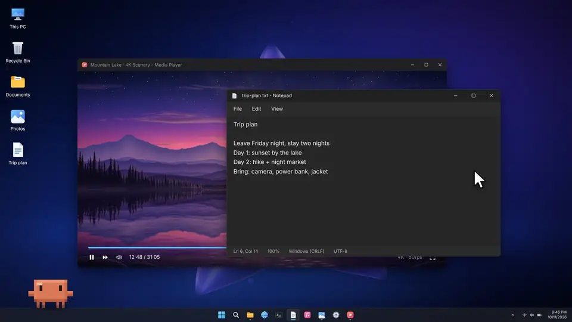

### Hold Win for the mini taskbar

Hold Win for 1 second (adjustable) and the mini taskbar rises from the bottom: pinned apps, open windows, hidden tray icons, the clock, volume and brightness sliders, plus Wi-Fi and Bluetooth toggles. Hover a window icon for a live thumbnail. A short press of Win still opens the Start menu.

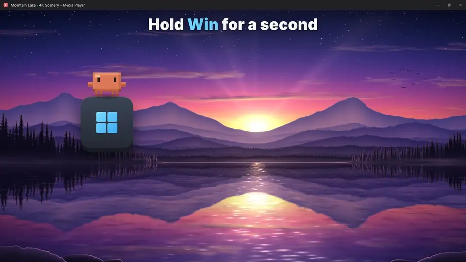

### Tap Win while the taskbar is hidden

When the taskbar is hidden, a short press of Win first raises a one-row mini taskbar, then opens the Start menu as usual. Both go away when Start closes.

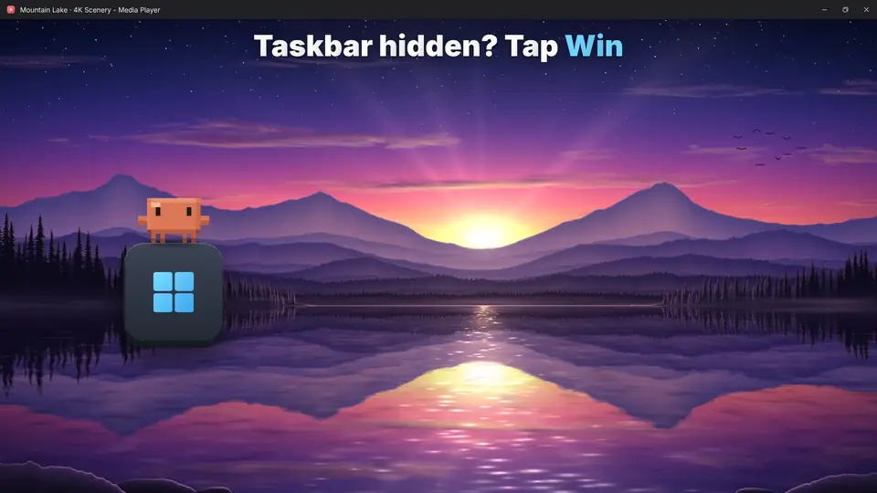

### Tray icons

The icons hidden in the system tray are in the mini taskbar too, stacked four at a time by default; scroll or press ← → to flip pages. Left-click works like the system tray; right-click opens a menu, and "App menu" opens the program's own menu.

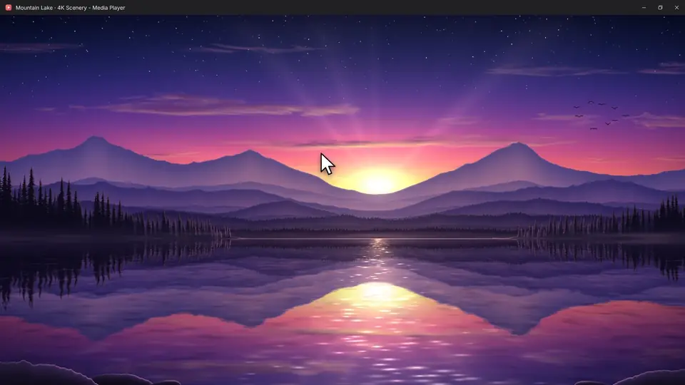

### Volume, brightness, Wi-Fi and Bluetooth

Drag or scroll to set volume and brightness. Click the Wi-Fi or Bluetooth button to turn it on or off; right-click it for the system's network list or Bluetooth device list.

### Media, input mode and battery

Next to the clock you'll find what's playing: its cover art and title above pause, previous and next; the input mode (中 / 英 for Chinese), which you can click to switch; and on laptops, the battery level and charging state. Turn off what you don't need on the Status & controls page in Settings; the clock settings are there too, where you can add the weekday or seconds, or drop the date.

### New message alerts

While the taskbar is hidden, when a program flashes on the taskbar (a new message, for example), an orange glow lights up in the middle of the bottom edge, and its icon in the mini taskbar turns orange. Both go away once you switch to it.

### Open by resting the mouse on the edge

Turn it on in Settings. While the taskbar is hidden, rest the mouse on the bottom edge of the screen (or the side the mini taskbar is on) and the mini taskbar appears without taking focus from your window. If you don't click it, it closes when the mouse moves away.

### Type to filter

Start typing once it's open to filter windows and pinned apps. Programs from the Start menu show up too. Press Enter to open.

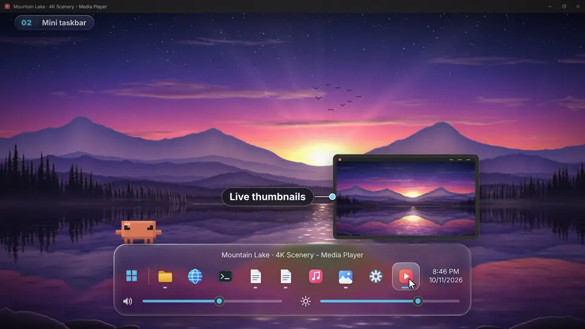

### Right-click menu

Works like the system taskbar: recent files, open another window, run as administrator, open file location, close windows. Middle-click an icon to close the window; right-click the Windows icon on the left for the Win+X menu.

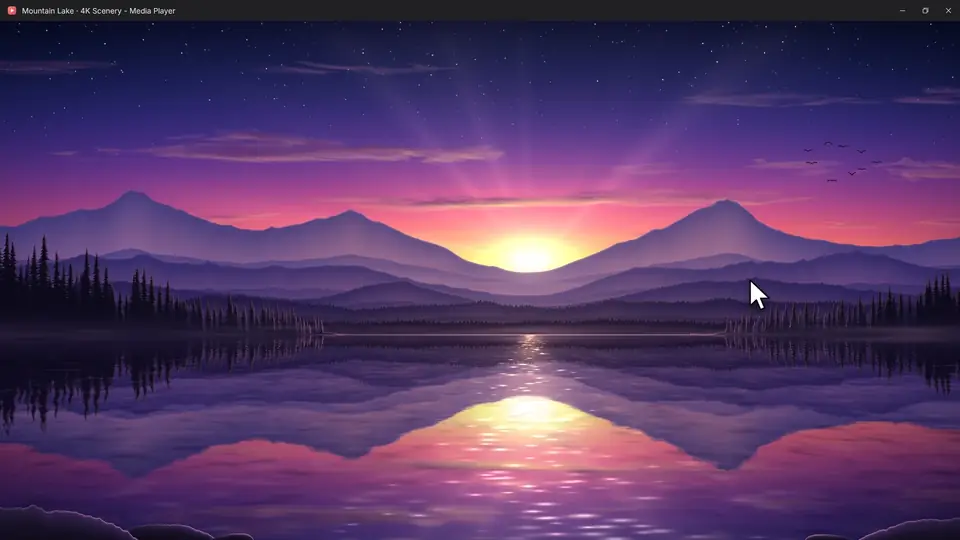

### Keep small windows on top

Double-click a small floating window (or use a hotkey) and it stays on top even when you click the full-screen window behind it. Turn on "Keep pinned windows above all windows" (off by default) in Settings to keep it above every window.

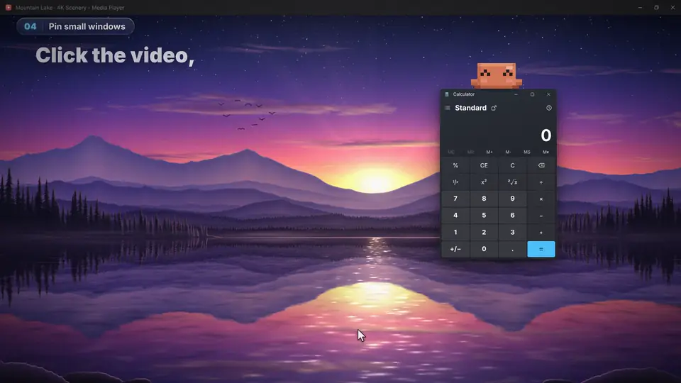

### Hotkeys

Set one hotkey to open the mini taskbar and one to pin a small window. Key combos, single keys and mouse buttons all work, triggered by a tap or a hold. None are set by default.

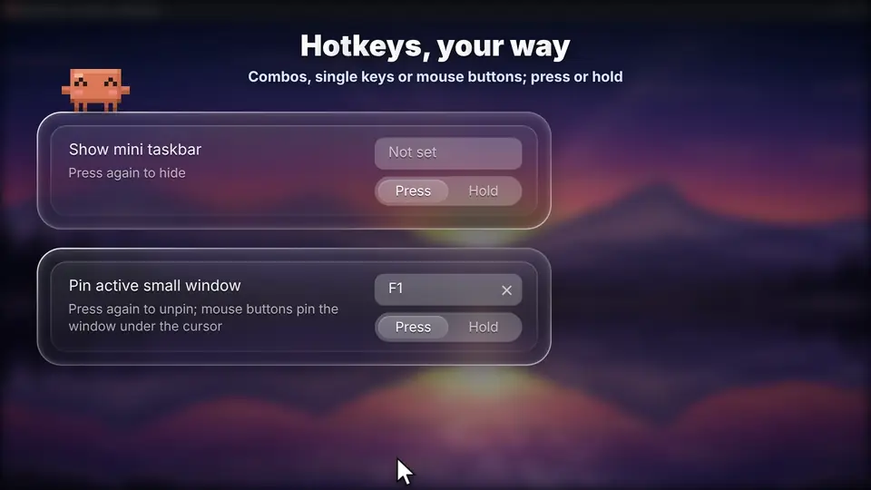

### Appearance

Choose liquid glass or the original Windows 11 look (the system's acrylic: a solid tint, crisp text and a thin border), and a system, light or dark theme. The accent color follows Windows unless you pick your own, and the mini taskbar can have its own tint. Corner radius, transparency, icon size and spacing preview live as you change them. You can also turn off the title row; window names then show above the panel.

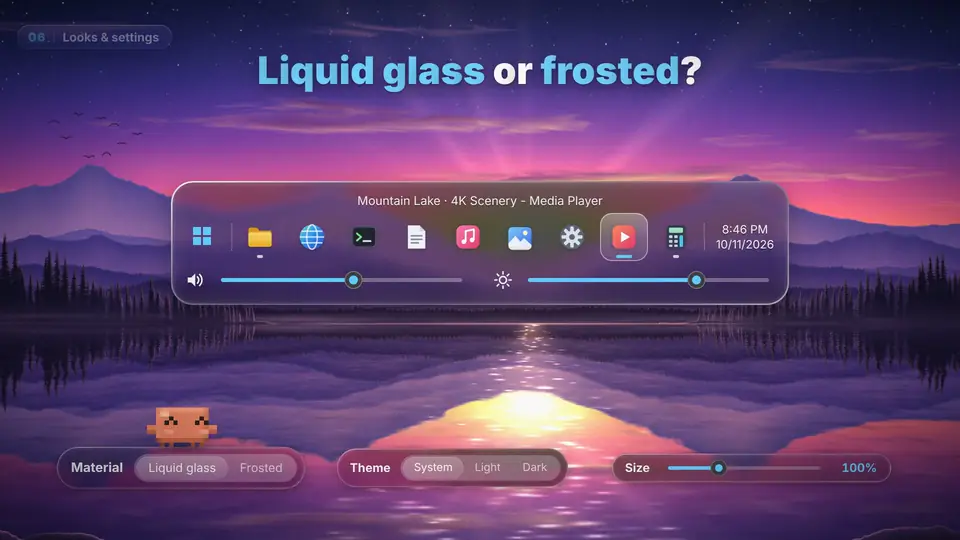

### Edit mode

Press F2 while the mini taskbar is open to arrange it your way:

- Drag the top edge to change its size (50 – 200%) and the ends to change its length (on a screen side, the inner edge and the top and bottom ends). Double-click an edge to reset it.
- Drag the tray icons, media, input mode, battery or clock to reorder them, or drag one off the panel to hide it. The volume and brightness sliders and the Wi-Fi and Bluetooth toggles can be dragged off too.
- Drag the window icons or empty space to slide the whole panel anywhere along the screen edge; it snaps to the center and the ends. Double-click to reset.
- Right-click to choose what shows, or reset the order and position. Press Enter or Esc when you're done.

### Presets and backup

On the Presets & backup page in Settings, save the current look as a preset (up to 8) and switch back to it with one click: material, colors, size, position and which items show all change together. Export saves all your settings to a file; import it on a new PC to get everything back.

### Position and alignment

Put the mini taskbar at the bottom, or stand it vertically on the left or right screen edge. At the bottom it can follow the system, or be centered, left or right aligned, and in edit mode you can drag it anywhere.

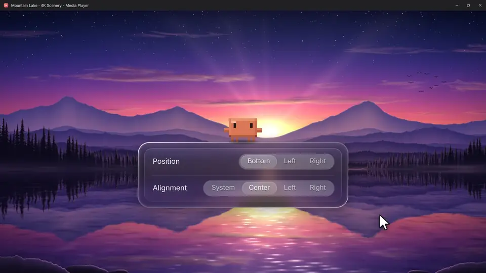

## Download

Get the latest `TaskbarPopup.zip` from [Releases](../../releases), unzip it and run `TaskbarPopup.exe`. A blue up-arrow icon appears in the tray: left-click it to open the mini taskbar, right-click it for the menu and Settings.

## Mini taskbar controls

| Action | Result |
| --- | --- |
| Hold Win / hotkey | Open / close |
| Click an icon | Switch to that window (click the active one to minimize); start a pinned app that isn't running |
| Shift + click | Open another window |
| Right-click / Menu key | Right-click menu |
| Middle-click / Delete | Close the window |
| Arrow keys / Tab, Enter | Select and open with the keyboard |
| Type | Filter; Esc clears, press again to close |
| Mouse wheel | Scroll the icons; over a slider, adjust volume / brightness |
| Windows icon on the left | Click for Start, right-click for the Win+X menu |
| Tray icons | Left-click works like the system tray; right-click opens a menu, and "App menu" opens the program's own menu |
| Wi-Fi / Bluetooth buttons | Click to turn on or off; right-click to open the system's network list or Bluetooth device list (Bluetooth on Windows 10 opens Settings) |
| Media buttons | Pause / play, previous, next |
| Input mode | Click to switch between native and English input |
| Rest the mouse on the edge | Opens (turn it on in Settings) and closes when the mouse moves away; once clicked, it works as usual |
| F2 | Enter or leave edit mode: drag edges to resize, items to reorder, empty space to move |
| Esc / click elsewhere | Close |

## Settings

Right-click the tray icon → Settings. Options are grouped into Taskbar, Mini taskbar, Status & controls, Size & position, Appearance, Presets & backup, Hotkeys, and Startup & updates; switch with the navigation on the left (or Ctrl+Tab). Tab, arrow keys and Space work too. Settings are stored in `%APPDATA%\TaskbarPopup\settings.ini`.

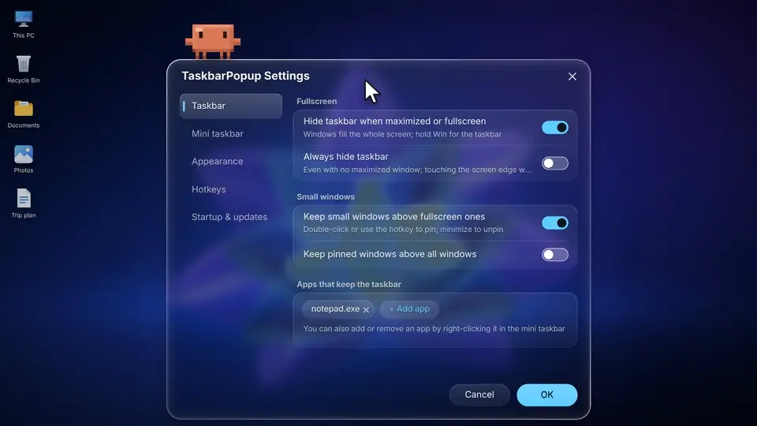

**Multiple monitors**: the mini taskbar opens on the display with the mouse by default; on the Mini taskbar page you can make it open on the active window's display instead. If Windows is set to show taskbar apps only on the taskbar where the window is open, it lists only the windows on that display. Turn on "Set position for each display" on the Size & position page, and position and alignment apply to whichever display the Settings window is on. While the active window is maximized, other displays that also have a maximized window keep their taskbars hidden too, so switching between them no longer slides the taskbars back and forth.

"Auto-check for updates" is off by default. When on, it checks GitHub Releases once a day and only notifies you; it never downloads or installs anything by itself.

**Having a problem?** In the tray menu, turn on "Record diagnostic log", reproduce the problem, then click "Open diagnostic log folder" and send the `debug.log`.

## Known limitations

- **Holding Win does nothing in admin programs and games**: Windows doesn't pass their key presses to a normal-privilege program. Tick "Run as administrator" in the tray menu. With start-at-login on as well, there's no UAC prompt at startup.
- **Edge / Chrome may show a thin line (about 2 px) at the bottom**: the browser leaves it for the auto-hidden taskbar and it can't be changed from outside.
- **Multiple monitors**: system auto-hide applies to every monitor, so while a window is maximized, the taskbars on monitors without a maximized window auto-hide too.
- **Notifications may not show while maximized**: go to Settings → System → Notifications → Turn on do not disturb automatically, and turn off "When using an app in full-screen mode".
- **Some windows won't stretch**: the taskbar stays visible while that window is in front.
- **Taskbar settings locked** (for example by group policy on a work PC): the taskbar stays visible.
- **Old games in exclusive full screen** cover the mini taskbar. Switch the game to borderless windowed.
- **Brightness on external monitors** needs DDC/CI supported and turned on in the monitor; otherwise the slider is grayed out.
- **Wi-Fi / Bluetooth button grayed out**: the adapter is turned off by a hardware switch or disabled in Device Manager. A radio the PC doesn't have isn't shown.
- **Media** shows only what appears in the system's volume flyout (most browsers and players do).
- **Input mode**: a few third-party IMEs manage Chinese / English themselves, so the indicator may be off and clicking may not switch. Use the IME's own shortcut then.
- **Tray icons** are clicked for you in the system tray through UI Automation, which may miss for a few programs. If it does, try once with the diagnostic log on.
- **The mini taskbar's glass background** is a snapshot from when it opened, so a video playing behind it won't move.
- **Antivirus false positives**: the exe isn't signed and uses keyboard and mouse hooks (only to detect holding Win and your hotkeys; no keys are recorded or sent anywhere). Release builds are compiled from source by GitHub Actions. If it's blocked, allow it in Windows Security → Protection history.
- **Taskbar missing after force-killing the app**: start the app again and it restores everything.

## Building from source

Requires C++17. From the repository root:

- **Visual Studio 2022**: `cmake -B build -G "Visual Studio 17 2022" -A x64`, then `cmake --build build --config Release`
- **MSYS2 / MinGW-w64**: `cmake -B build -G "MinGW Makefiles" -DCMAKE_BUILD_TYPE=Release`, then `cmake --build build`
- **Cross-compile on Linux** (needs `g++-mingw-w64-x86-64-posix`): `sh build-mingw.sh`

## Code layout

| File | Purpose |
| --- | --- |
| `src/main.cpp` | Entry point, tray menu, settings, start at login |
| `src/fullscreen.cpp` | Detect maximized windows, hide the taskbar, stretch the window |
| `src/taskbar_anim.cpp` | Taskbar slide out / in animation |
| `src/desktop_icons.cpp` | Save and restore desktop icon positions |
| `src/hook.cpp` | Keyboard and mouse hooks: holding Win and hotkeys |
| `src/popup.cpp` | The mini taskbar |
| `src/glass.cpp` | Liquid glass material |
| `src/float_windows.cpp` | Keep small windows on top |
| `src/hotkeys.cpp` | Hotkeys |
| `src/thumbnail.cpp` | Window thumbnails |
| `src/apps.cpp` | App list for type-to-filter |
| `src/pinned.cpp` | Taskbar pinned list |
| `src/tray.cpp` | Hidden tray icons |
| `src/app_menu.cpp` | Right-click menu |
| `src/windows.cpp` | List windows, get icons |
| `src/levels.cpp` | Volume and brightness |
| `src/radios.cpp` | Wi-Fi and Bluetooth toggles |
| `src/media.cpp` | Now playing |
| `src/indicators.cpp` | Battery and input mode |
| `src/attention.cpp` | New message alerts |
| `src/elevation.cpp` | Run as administrator |
| `src/update.cpp` | Update check |
| `src/settings_dialog.cpp` | Settings window |
| `src/util.cpp` | Utilities, diagnostic log |
| `src/version.h` | Version number |

## License

[GNU AGPL-3.0](LICENSE)
