[简体中文](README.md) | English

# TaskbarPopup

A Windows 10/11 taskbar enhancement. Maximizing a window hides the taskbar and lets the window fill the screen. Hold Win to open a liquid-glass mini taskbar on your selected screen edges. Single exe, no runtime to install.

> The interface comes in English and Chinese. It follows your Windows display language; change it under Settings → Appearance → Language.

Demo video: [YouTube](https://youtu.be/nTGIbGz5Qlw)

## Features

### Maximize means full screen

Maximize a window and the taskbar slides away while the window fills the screen. Restore, minimize or close it and the taskbar slides back, with your desktop icons right where they were.

You can also turn on "Always hide taskbar" in Settings (off by default): the taskbar stays hidden even with no maximized window, and touching the screen edge won't bring it up. Hold Win when you need it.

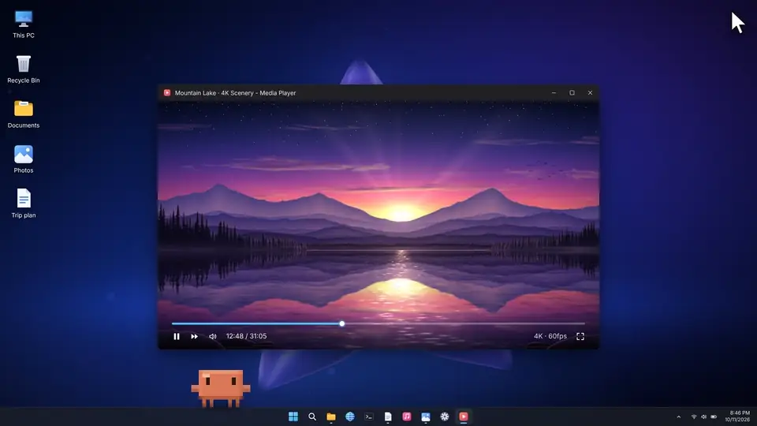

### Per-app rule

Right-click an app in the mini taskbar and tick "Don't hide taskbar when maximized": the taskbar stays when that app is maximized. If you turn off "Hide taskbar when maximized or fullscreen" in Settings, the item becomes "Hide taskbar when maximized" and only the ticked apps hide the taskbar.

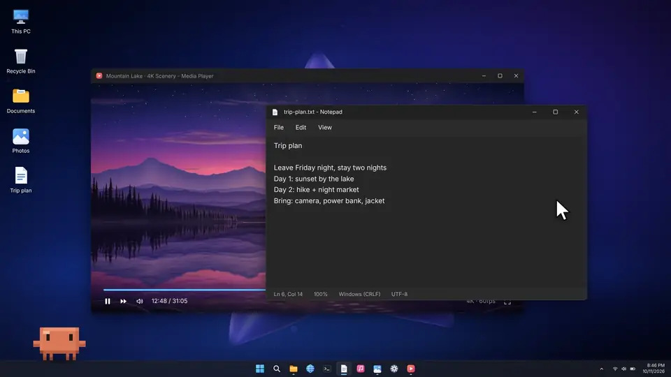

### Hold Win for the mini taskbar

Hold Win for 1 second (adjustable) to open the mini taskbar on your selected screen edges. The bottom edge is the default. The bar can show pinned apps, open windows, hidden tray icons, the clock, and system controls. A short press of Win still opens the Start menu.

When a pinned app opens, its windows appear with the other open windows, to the right of unopened pins on the bottom bar. Closing its last window returns the icon to its original place among the pins.

Multiple windows from one app share a stacked icon. Hover or click the icon to see window titles and thumbnails. Hover a thumbnail for a larger preview, click it to switch to that window, or use its × button to close it. Scroll over the icon or the thumbnails to turn pages. Select the stacked icon with the keyboard and press Enter to switch by title.

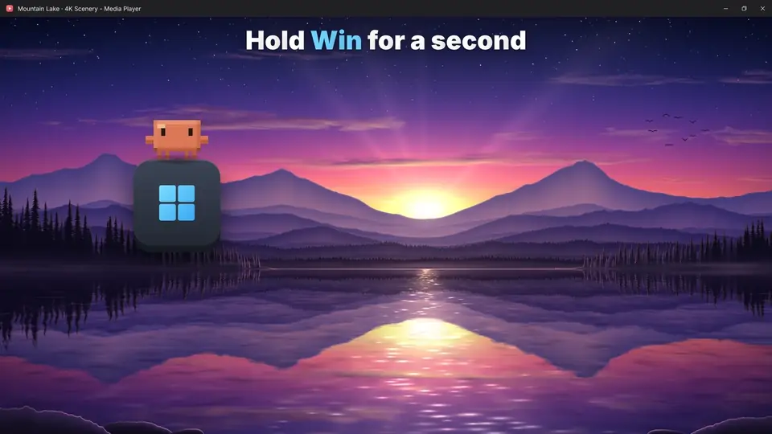

### Tap Win while the taskbar is hidden

When the taskbar is hidden, a short press of Win can open the system Start menu with a one-row mini taskbar. With multiple displays, the mini taskbar follows the display that hosts Start. Both go away when Start closes.

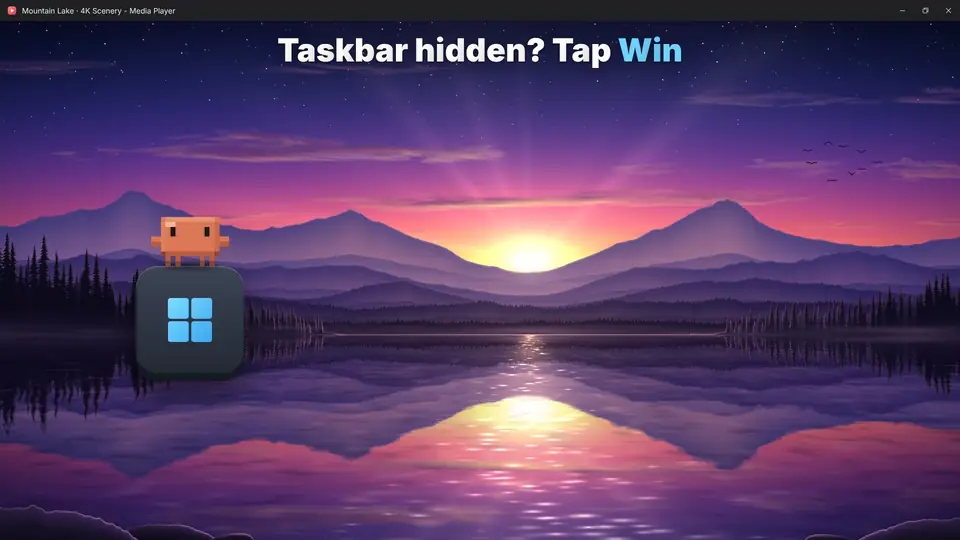

### Tray icons

Hidden tray icons are stacked four at a time by default. Scroll or press ← → to turn pages. Choose "In a row" in Status & controls, or stretch or shrink the tray in edit mode to switch between styles.

Left-click works like the system tray. Right-click opens the app's tray menu directly. Menus that support positioning open next to the icon on the mini taskbar. When the taskbar is hidden, the app masks the system tray while opening it to deliver the click.

### Volume, brightness, Wi-Fi and Bluetooth

Drag or scroll to set volume and brightness. Right-click the volume control to pick a playback device, for example to switch between speakers and headphones. Click the Wi-Fi or Bluetooth button to turn it on or off; right-click it for the system's network list or Bluetooth device list. Volume and brightness can be turned off separately on the Status & controls page of Settings, and the "Capsule" button next to each switches it to a thick capsule instead of a thin track with a round thumb. At the bottom, a capsule is as tall as the icons and sits in the icon row. Whether a control lies across or stands up follows the shape of its box in edit mode, in either style.

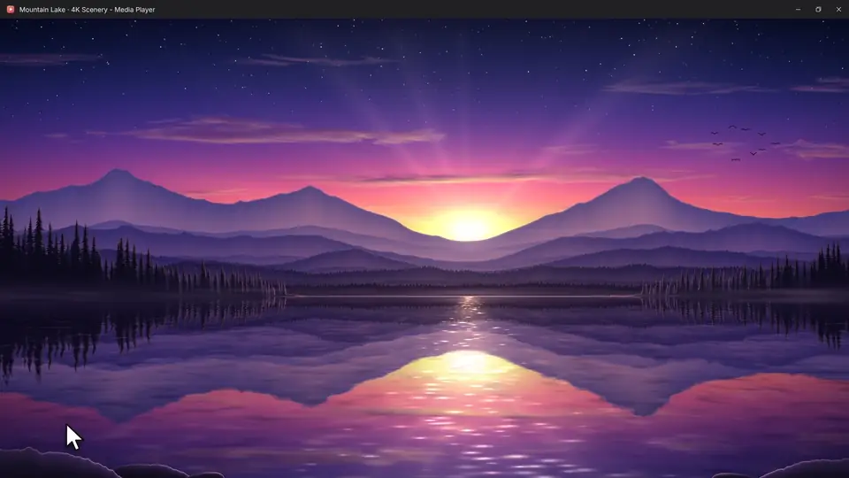

### Media, input mode and battery

Next to the clock you'll find the cover art of what's playing; point at it to see the title. Click the cover and previous, pause / play and next pop out over it; they tuck away when the mouse leaves. When something starts playing, it is added onto the panel, which gets a little longer while the icons keep their size (also when you have arranged items yourself: it takes no room while nothing plays and slots back into its place when something does). There's also the input mode (中 / 英 for Chinese), which you can click to switch, and on laptops, the battery level and charging state. Turn off what you don't need on the Status & controls page in Settings; pick Bottom, Left, or Right under "Settings for" first. A bar you've arranged in edit mode can also turn off its Start button and window icons there. The mini taskbar pops up to show each change. If turning things off leaves empty space on the panel, the remaining icons grow to fill it (up to 150%). The clock settings are there too, where you can add the weekday or seconds, or drop the date.

### New message alerts

While the taskbar is hidden, when a program flashes on the taskbar (a new message, for example), an orange glow lights up in the middle of the bottom edge, and its icon in the mini taskbar turns orange. Both go away once you switch to it.

### Open by resting the mouse on the edge

Turn it on in Settings. While the taskbar is hidden, rest the mouse on the bottom edge of the screen (or the side the mini taskbar is on; with two bars, the edge you rest on opens its bar) and the mini taskbar appears without taking focus from your window. If you don't click it, it closes when the mouse moves away.

### Type to filter

Start typing once it's open to filter windows and pinned apps. Programs from the Start menu show up too. Press Enter to open.

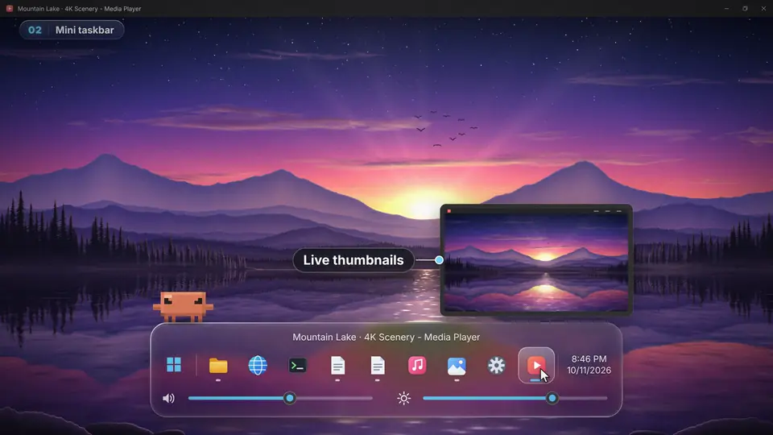

### Right-click menu

Works like the system taskbar: recent files, open another window, run as administrator, open file location, close windows. Middle-click an icon to close the window; right-click the Windows icon on the left for the Win+X menu.

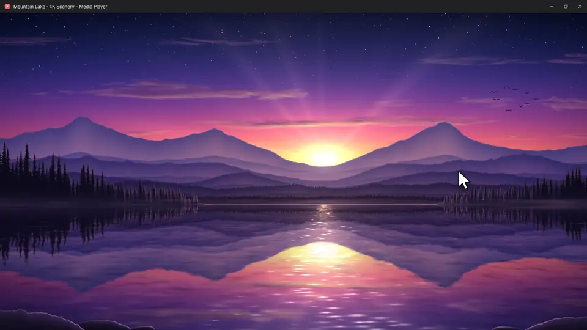

### Keep small windows on top

Double-click a small floating window (or use a hotkey) and it stays on top even when you click the full-screen window behind it. Turn on "Keep pinned windows above all windows" (off by default) in Settings to keep it above every window.

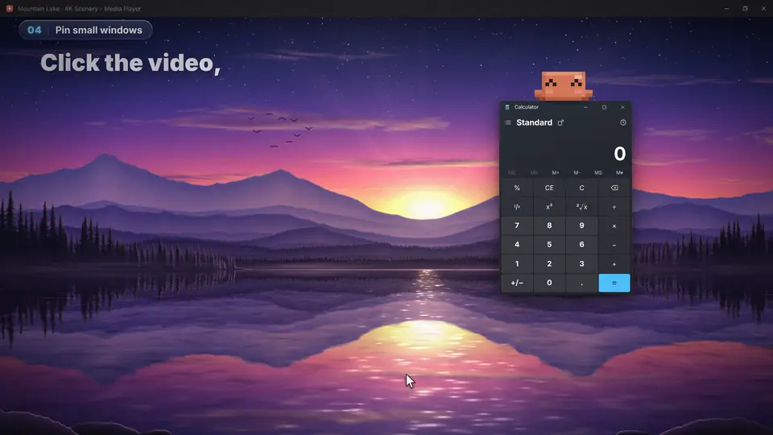

### Hotkeys

Set hotkeys to open Settings, open the configured mini taskbars together, toggle just the bottom, left, or right bar, pin a small window, move a window, or open on the next display. Key combos, single keys, and mouse buttons can trigger on a tap or hold. None are set by default.

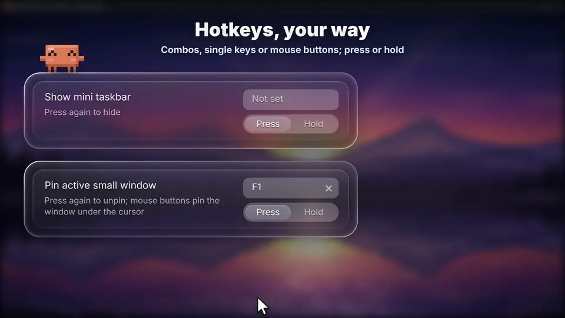

### Appearance

Choose liquid glass or the original Windows 11 look (the system's acrylic: a solid tint, crisp text and a thin border), and a system, light or dark theme. On liquid glass the text color follows what's behind it: each icon and item checks how bright the background is and uses dark text on bright areas and white text on dark ones, so it stays readable on a half-bright wallpaper or at high transparency. The accent color follows Windows unless you pick your own, and the mini taskbar can have its own tint. Corner radius, transparency, icon size and spacing preview live as you change them, and when the bottom and side bars show together each has its own corner radius. Once you've arranged items in edit mode, icon size only changes the icons; the panel and the items' boxes stay the same. You can also turn off the title row; window names then show above the panel.

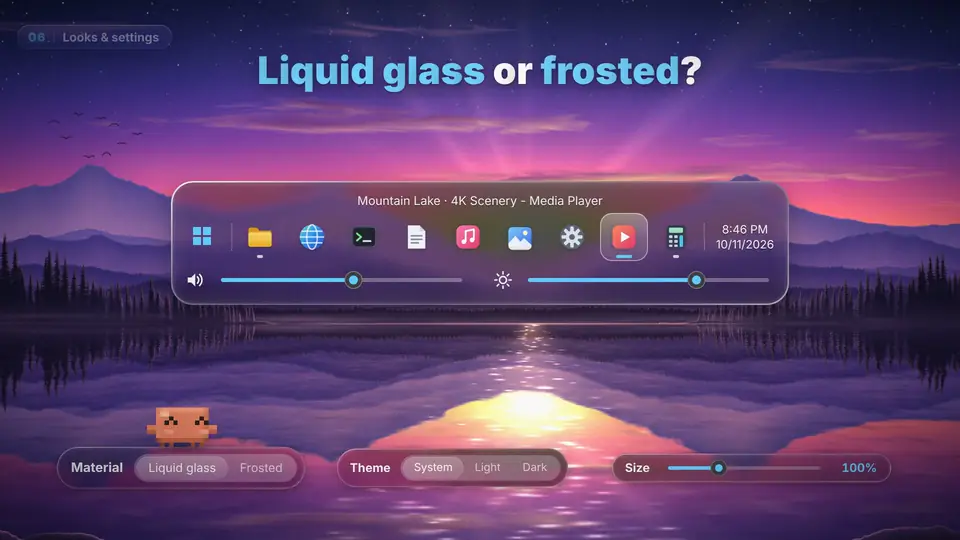

### Edit mode

Press F2 while the mini taskbar is open, or click "Edit" on the Size & position page of Settings. Each open bar shows its edge label (Bottom, Left, or Right).

- Changes preview immediately. Press Enter or F2 to save and exit, or Ctrl+Z to undo the last change. Esc cancels the current drag. When no drag is active, Esc or closing the mini taskbar discards the edits.
- Drag items to arrange them. A dashed outline shows the drop position, with snapping to nearby items and the center. When you drag to another bar, that bar highlights and previews the drop. A transfer counts as one change. Releasing outside a bar, on a bar with the same module, or where the item cannot fit returns it to its original position.
- In the ordered layout, drag an inner edge to scale all bars (50–200%) or either end to change that bar's length. In the free layout, drag the edges to resize that bar's module area and double-click one to trim empty space.
- Drag a corner dot to resize an item or double-click to reset it. In the free layout, hold Shift to keep the aspect ratio. A longer window or tray box shows more icons, and the sliders and wireless controls follow the shape of their boxes. Drag the handles between window icons to change icon spacing across all bars, or double-click to reset it. Hold Ctrl while scrolling to resize an item, change spacing over a gap, or scale all bars over empty space. Scroll normally to browse window or tray icons.
- Drag empty space to move that bar along its screen edge. It snaps to the center and ends. Double-click to reset its position.
- Right-click to show or hide modules, remember or restore this bar's layout, or reset this bar's layout or position. Remembered layouts are saved with the rest of the edits.

### Presets and backup

On the Presets & backup page in Settings, save the current look as a preset (up to 8) and switch back to it with one click: material, colors, size, position and which items show all change together. Export saves all your settings to a file; import it on a new PC to get everything back.

### Position and alignment

Place the mini taskbar at the bottom, on either side, or on two edges. Choose **All three** under **Size & position** to open the bottom, left, and right bars together from the tray, by holding Win, or with the mini taskbar hotkey. Use **Status & controls → Settings for** to choose modules for the bottom, left, or right bar. Each bar saves its own layout, placement, and corner radius. The bottom can follow the system, be centered, or align left or right, and edit mode lets you drag it into position. Set individual hotkeys to open or close each edge separately.

When you switch to **All three** from the original layout, the bottom bar holds Start and app windows, the left bar holds hidden tray icons, and the right bar holds media, input, the clock, volume, brightness, Wi-Fi, and Bluetooth. Saved custom layouts take precedence.

In this mode, press **F2**, right-click the bar you want to restore, and choose **Reset this bar's layout** or **Reset this bar's position**. Press **Enter** to save.

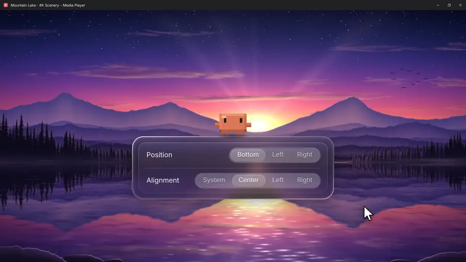

## Download

Download the ZIP for your architecture from Assets on the [Releases](../../releases) page, for example `TaskbarPopup_v1.2.1.zip` (x64) or `TaskbarPopup-arm64_v1.2.1.zip` (ARM64). Unzip it and run `TaskbarPopup.exe`. Left-click the blue up-arrow icon in the tray to open the mini taskbar, or right-click it for the menu and Settings.

## Mini taskbar controls

| Action | Result |
| --- | --- |
| Hold Win / hotkey | Open / close |
| Click an icon | Switch to the window, minimize it if active, or start the pinned app. Click a stacked icon to open thumbnails |
| Click a thumbnail / its × button | Switch to / close the corresponding window |
| Shift + click | Open another window |
| Right-click / Menu key | Right-click menu |
| Middle-click / Delete | Close the window. For a stack, choose which window to close |
| Arrow keys / Tab, Enter | Select and open with the keyboard |
| Type | Filter; Esc clears, press again to close |
| Mouse wheel | Scroll the icons; over a slider, adjust volume / brightness |
| Windows icon on the left | Click for Start, right-click for the Win+X menu |
| Tray icons | Left-click works like the system tray. Right-click opens the app's tray menu directly |
| Volume | Click the speaker to mute; right-click to switch the playback device |
| Wi-Fi / Bluetooth buttons | Click to turn on or off; right-click to open the system's network list or Bluetooth device list (Bluetooth on Windows 10 opens Settings) |
| Media | Click the cover for previous, pause / play and next; they hide when the mouse leaves |
| Input mode | Click to switch between native and English input |
| Rest the mouse on the edge | Opens (turn it on in Settings) and closes when the mouse moves away; once clicked, it works as usual |
| F2 | Enter edit mode or save and exit |
| Enter / Esc / Ctrl+Z (while editing) | Save and exit / cancel the drag or edits / undo the last change |
| Ctrl+scroll (while editing) | Resize the module under the pointer, adjust icon spacing, or scale all bars |
| Esc / click elsewhere | Close |

## Settings

Right-click the tray icon → Settings. Options are grouped into Taskbar, Mini taskbar, Status & controls, Size & position, Displays, Appearance, Presets & backup, Hotkeys, and Startup & updates; switch with the navigation on the left (or Ctrl+Tab). Tab, arrow keys and Space work too. Changes take effect right away; there is no OK button. Settings are stored in `%APPDATA%\TaskbarPopup\settings.ini`.

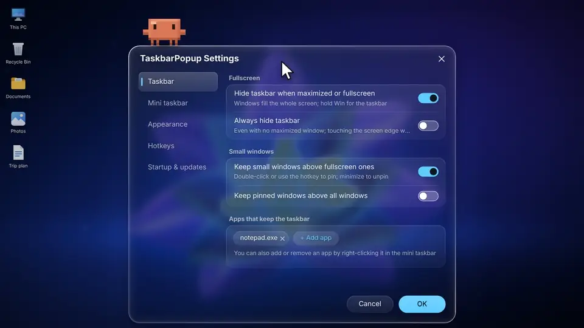

**Multiple monitors** (the Displays page in Settings):

- When a window is maximized on one display, only that display's taskbar hides; the other displays keep theirs. Edge, Chrome and similar apps (and apps that won't fill the screen when stretched) still need Windows' auto-hide, which hides the taskbars on all displays. Turn off "Keep taskbars on other displays" to treat every app that way.
- Untick a display under "Hide taskbar on" and maximizing a window there keeps its taskbar.
- Other displays that also have a maximized window keep their taskbars hidden too, so switching between them no longer slides the taskbars back and forth.
- The mini taskbar opens on the display with the mouse by default, or on the active window's display if you choose. The "Show mini taskbar on next display" hotkey moves it to the next display.
- "Windows shown" follows Windows by default (if Windows shows taskbar apps only where the window is open, it lists only that display's windows), or pick All displays or This display. Windows on other displays have the display number on their icon.
- Right-click a window icon → Move to other display (pick one when there are three or more). A maximized window stays maximized. A hotkey can move the active window to the next display.
- Turn on "Adjust brightness on all displays" and the brightness slider changes every display.
- After you plug in or unplug a monitor or change the resolution, the taskbars and the mini taskbar are laid out for the new displays.
- Turn on "Set position for each display" on the Size & position page, and position and alignment apply to whichever display the Settings window is on.

"Auto-check for updates" is off by default. When on, it checks GitHub Releases once a day and only notifies you; it never downloads or installs anything by itself.

**Having a problem?** In the tray menu, turn on "Record diagnostic log", reproduce the problem, then click "Open diagnostic log folder" and send the `debug.log`.

## Known limitations

- **Holding Win does nothing in admin programs and games**: Windows doesn't pass their key presses to a normal-privilege program. Tick "Run as administrator" in the tray menu. With start-at-login on as well, there's no UAC prompt at startup.
- **Edge / Chrome may show a thin line (about 2 px) at the bottom**: the browser leaves it for the auto-hidden taskbar and it can't be changed from outside.
- **Multiple monitors**: Edge, Chrome and similar apps need Windows' auto-hide when maximized. It applies to every monitor, so the taskbars on the other monitors auto-hide too. The same happens when only one monitor has a taskbar.
- **Notifications may not show while maximized**: go to Settings → System → Notifications → Turn on do not disturb automatically, and turn off "When using an app in full-screen mode".
- **Some windows won't stretch**: the taskbar stays visible while that window is in front.
- **Taskbar settings locked** (for example by group policy on a work PC): the taskbar stays visible.
- **Old games in exclusive full screen** cover the mini taskbar. Switch the game to borderless windowed.
- **Brightness on external monitors** needs DDC/CI supported and turned on in the monitor; otherwise the slider is grayed out.
- **Wi-Fi / Bluetooth button grayed out**: the adapter is turned off by a hardware switch or disabled in Device Manager. A radio the PC doesn't have isn't shown.
- **Media** shows only what appears in the system's volume flyout (most browsers and players do).
- **Input mode**: a few third-party IMEs manage Chinese / English themselves, so the indicator may be off and clicking may not switch. Use the IME's own shortcut then.
- **Tray icons** are clicked for you in the system tray through UI Automation, which may miss for a few programs. If it does, try once with the diagnostic log on.
- **The mini taskbar's glass background** follows what's behind it in real time, like the Settings window. This needs Windows 10 2004 or later; on older versions it's a snapshot from when it opened.
- **Antivirus false positives**: the exe isn't signed and uses keyboard and mouse hooks (only to detect holding Win and your hotkeys; no keys are recorded or sent anywhere). Release builds are compiled from source by GitHub Actions. If it's blocked, allow it in Windows Security → Protection history.
- **Taskbar missing after force-killing the app**: start the app again and it restores everything.

## Building from source

Requires C++17. From the repository root:

- **Visual Studio 2022**: `cmake -B build -G "Visual Studio 17 2022" -A x64` (or `-A ARM64` for ARM64), then `cmake --build build --config Release`
- **MSYS2 / MinGW-w64**: `cmake -B build -G "MinGW Makefiles" -DCMAKE_BUILD_TYPE=Release`, then `cmake --build build`
- **Cross-compile on Linux** (needs `g++-mingw-w64-x86-64-posix` for x64, `llvm-mingw` for arm64): `sh build-mingw.sh` (or `TARGET_ARCH=arm64 sh build-mingw.sh`)

## Code layout

| File | Purpose |
| --- | --- |
| `src/main.cpp` | Entry point, tray menu, settings, start at login |
| `src/fullscreen.cpp` | Detect maximized windows, hide the taskbar, stretch the window |
| `src/taskbar_anim.cpp` | Taskbar slide out / in animation |
| `src/desktop_icons.cpp` | Save and restore desktop icon positions |
| `src/hook.cpp` | Keyboard and mouse hooks: holding Win and hotkeys |
| `src/popup.cpp` | The mini taskbar |
| `src/glass.cpp` | Liquid glass material |
| `src/float_windows.cpp` | Keep small windows on top |
| `src/hotkeys.cpp` | Hotkeys |
| `src/thumbnail.cpp` | Window thumbnails |
| `src/apps.cpp` | App list for type-to-filter |
| `src/pinned.cpp` | Taskbar pinned list |
| `src/tray.cpp` | Hidden tray icons |
| `src/app_menu.cpp` | Right-click menu |
| `src/windows.cpp` | List windows, get icons |
| `src/levels.cpp` | Volume and brightness |
| `src/radios.cpp` | Wi-Fi and Bluetooth toggles |
| `src/media.cpp` | Now playing |
| `src/indicators.cpp` | Battery and input mode |
| `src/attention.cpp` | New message alerts |
| `src/elevation.cpp` | Run as administrator |
| `src/update.cpp` | Update check |
| `src/settings_dialog.cpp` | Settings window |
| `src/util.cpp` | Utilities, diagnostic log |
| `src/version.h` | Version number |

## License

[GNU AGPL-3.0](LICENSE)
