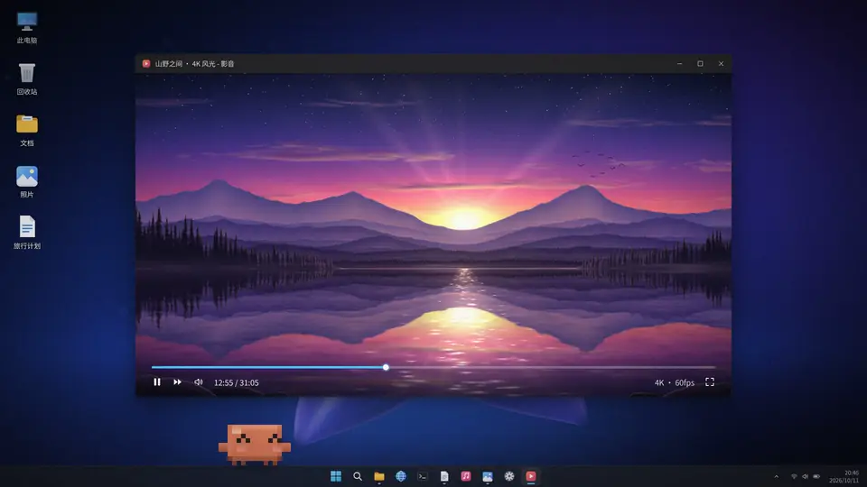
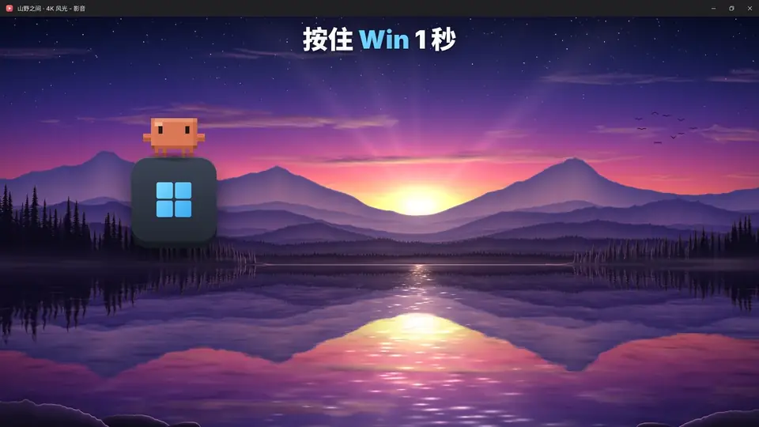
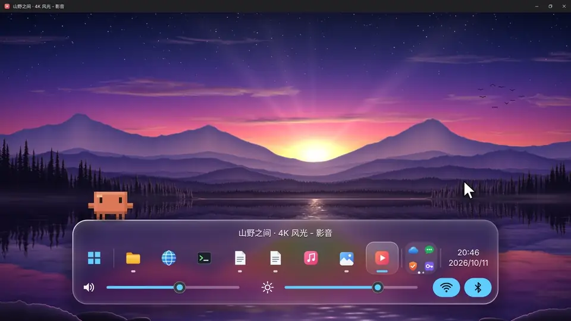
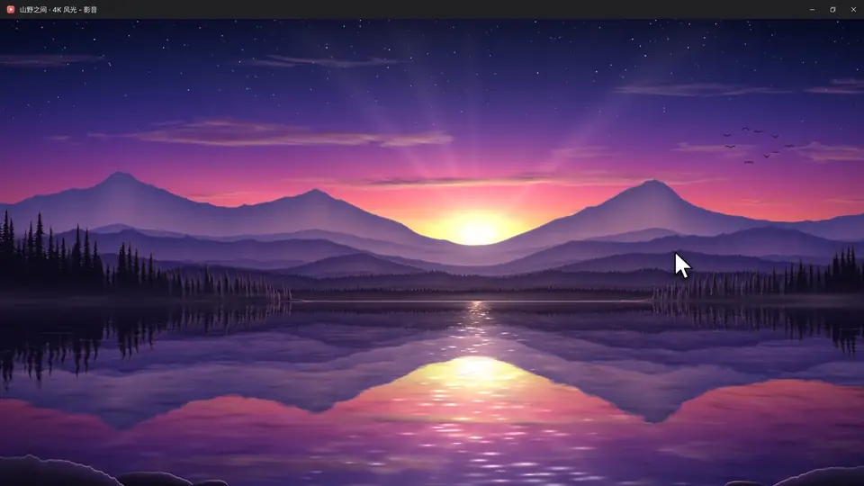
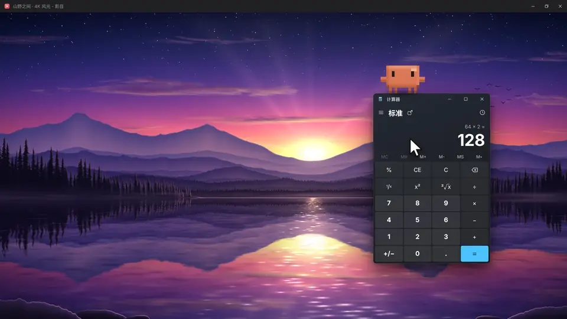
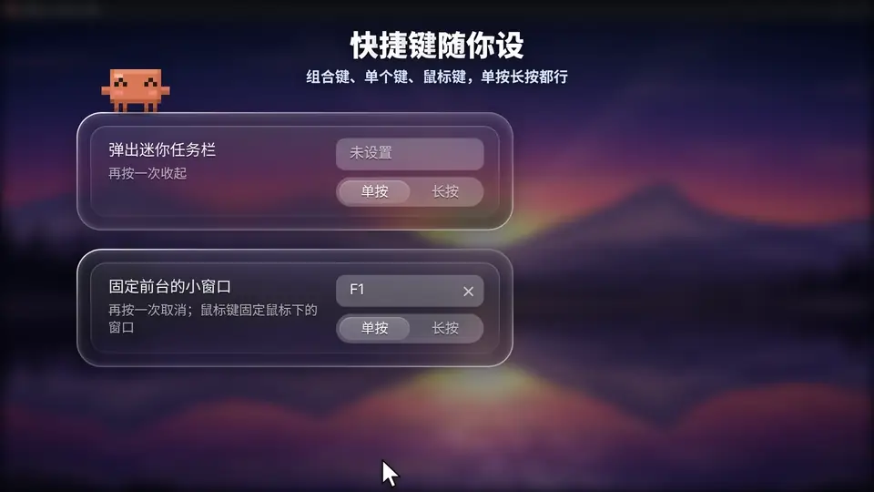
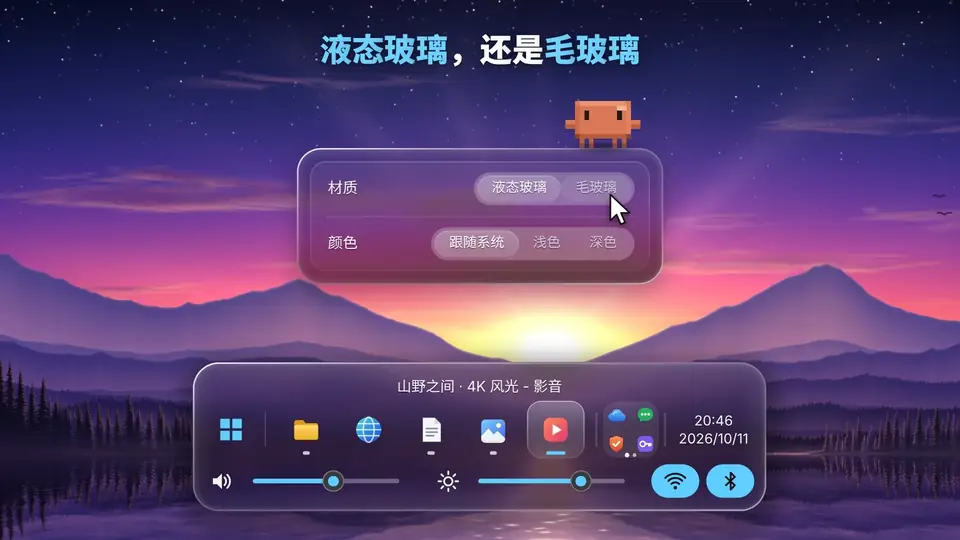

简体中文 | [English](README.en.md)

# TaskbarPopup

Windows 10/11 任务栏增强：窗口最大化时藏起任务栏、让窗口铺满整块屏幕；长按 Win 从屏幕底部弹出液态玻璃风格的迷你任务栏。单个 exe，不用装运行库。

功能演示视频：[哔哩哔哩](https://www.bilibili.com/video/BV1BLp963E7e/)

## 功能

### 最大化即全屏

窗口一最大化，任务栏就滑走，窗口铺满整块屏幕；还原、最小化或关掉后任务栏滑回来，桌面图标留在原处。

也可以在设置里打开“一直隐藏任务栏”（默认关闭）：没有窗口最大化时任务栏也藏着，鼠标碰到屏幕边上也不会弹出来，要用时长按 Win。

### 长按 Win 弹出迷你任务栏

按住 Win 1 秒（时长可改），底部弹出迷你任务栏（也可以放在屏幕左右两侧竖着排）：固定的应用、打开的窗口、托盘里隐藏的图标、时间，还有音量、亮度调节和 Wi-Fi、蓝牙开关。鼠标停在窗口图标上显示实时缩略图。短按 Win 照常打开开始菜单。

### 打字筛选

弹出后直接打字，筛选窗口和固定的应用，开始菜单里的程序也能搜到，回车打开。

### 右键菜单

和系统任务栏一样：最近打开的文件、再开一个、以管理员身份运行、打开文件所在的位置、关闭窗口。勾选“最大化时不隐藏任务栏”可以把某个程序排除在外；在设置里关掉“最大化或全屏时隐藏任务栏”后，这一项变成“最大化时隐藏任务栏”，只有勾了的程序最大化时才藏任务栏。中键点图标直接关闭窗口。

### 小窗口留在上面

双击浮着的小窗口（或按快捷键），之后点全屏窗口它也不会被盖住。在设置里打开“固定的小窗口在所有窗口上面”（默认关），它就盖在所有窗口上面。

### 快捷键

可以设一个弹出迷你任务栏的快捷键和一个固定小窗口的快捷键，组合键、单个键、鼠标键都行，单按或长按触发。默认都没设。

### 外观

材质选液态玻璃或毛玻璃，颜色选跟随系统、浅色或深色，界面语言选中文或 English；迷你任务栏的大小（50 – 200%）、液态玻璃的透明度、位置（底部、左侧、右侧）和在底部时的对齐（跟随系统、居中、靠左、靠右）改了马上能预览。

## 下载

到 [Releases](../../releases) 下载最新的 `TaskbarPopup.zip`，解压后运行 `TaskbarPopup.exe`，托盘区会出现一个蓝色向上箭头图标：左键弹出迷你任务栏，右键打开菜单和“设置...”。

## 迷你任务栏操作

| 操作 | 效果 |
| --- | --- |
| 长按 Win / 快捷键 | 弹出 / 收起 |
| 单击图标 | 切换到该窗口（点当前窗口则最小化），没打开的固定应用直接启动 |
| Shift + 单击 | 再开一个窗口 |
| 右键 / 菜单键 | 右键菜单 |
| 中键 / Delete | 关闭窗口 |
| 方向键 / Tab、回车 | 键盘选择并打开 |
| 直接打字 | 筛选；Esc 先清空，再按一次收起 |
| 滚轮 | 滚动图标；在调节条上调音量 / 亮度 |
| 左侧 Windows 图标 | 单击打开开始菜单，右键打开 Win+X 菜单 |
| 托盘图标 | 左键和在系统托盘里点一样；右键弹出菜单，选“程序菜单”弹出程序自己的菜单 |
| Wi-Fi / 蓝牙按钮 | 单击打开或关闭；右键弹出系统的网络列表、蓝牙设备列表（Win10 的蓝牙打开系统设置） |
| Esc / 点到别处 | 收起 |

## 设置

右键托盘图标 →“设置...”，选项分成任务栏、迷你任务栏、外观、快捷键、启动和更新几类，点左边的导航切换（Ctrl+Tab 也行），Tab、方向键、空格也能操作。设置保存在 `%APPDATA%\TaskbarPopup\settings.ini`。

**多块屏幕**：迷你任务栏默认弹在鼠标所在的屏幕上，可以在“迷你任务栏”页改成弹在前台窗口所在的屏幕上；系统设置成“任务栏应用显示在窗口所在的任务栏”时，只列这块屏幕上的窗口。打开“外观”页的“每块屏幕分别设置位置和对齐”后，把设置窗口拖到哪块屏幕上，改的就是那块屏幕的位置和对齐。前台窗口最大化时，其他屏幕上也有最大化窗口的话，那些屏幕的任务栏一起藏着，在它们之间切换时任务栏不再来回伸缩。

“自动检查更新”默认关闭，打开后每天查一次 GitHub Releases，有新版只提醒，不会自己下载或安装。

**遇到问题**：在托盘右键菜单里打开“记录诊断日志”，复现一次，再点“打开诊断日志所在文件夹”，把 `debug.log` 发过来。

## 已知限制

- **管理员权限的程序和游戏里长按 Win 没反应**：Windows 不把它们的按键交给普通权限的程序。在托盘右键菜单勾选“以管理员身份运行”即可；同时开着开机自启的话，开机不弹 UAC。
- **Edge / Chrome 底边可能有约 2 像素的细线**：浏览器给自动隐藏的任务栏留的，外部改不了。
- **多块屏幕**：系统的自动隐藏对所有屏幕一起生效，有最大化窗口时，其他没有最大化窗口的屏幕上的任务栏也会暂时自动隐藏。
- **最大化时通知可能不弹出**：到 设置 → 系统 → 通知 → 自动打开勿扰模式，关掉“全屏模式下使用应用时”。
- **个别窗口铺不满**：这个窗口在前台时任务栏照常显示。
- **任务栏设置被锁住**（比如公司电脑的组策略）：任务栏照常显示。
- **独占全屏的老游戏**会盖住迷你任务栏，改成“无边框窗口”即可。
- **外接显示器调亮度**需要显示器支持并打开 DDC/CI，不支持时亮度条是灰的。
- **Wi-Fi / 蓝牙按钮是灰的**：网卡被硬件开关或设备管理器禁用了。电脑上没有的那个不显示。
- **托盘图标**靠 UI 自动化在系统托盘里代点，个别程序可能点不中，这时请开着诊断日志试一次。
- **迷你任务栏的玻璃背景**是弹出那一刻的画面，后面播放的视频不会跟着动。
- **杀毒软件可能误报**：exe 没有数字签名，又用了键盘和鼠标钩子（只用来认长按 Win 和快捷键，不记录、不发送任何按键）。Release 里的 exe 由 GitHub Actions 从源码编译，被拦下时到 Windows 安全中心 → 保护历史记录 里允许。
- **强制结束本程序后任务栏没回来**：重新打开本程序就会恢复。

## 从源码编译

需要 C++17，在仓库根目录运行：

- **Visual Studio 2022**：`cmake -B build -G "Visual Studio 17 2022" -A x64`，再 `cmake --build build --config Release`
- **MSYS2 / MinGW-w64**：`cmake -B build -G "MinGW Makefiles" -DCMAKE_BUILD_TYPE=Release`，再 `cmake --build build`
- **Linux 交叉编译**（需要 `g++-mingw-w64-x86-64-posix`）：`sh build-mingw.sh`

## 代码结构

| 文件 | 作用 |
| --- | --- |
| `src/main.cpp` | 入口、托盘菜单、设置读写、开机自启 |
| `src/fullscreen.cpp` | 判断最大化的窗口，藏起任务栏、拉伸窗口 |
| `src/taskbar_anim.cpp` | 任务栏滑出 / 滑回的动画 |
| `src/desktop_icons.cpp` | 记下并摆回桌面图标 |
| `src/hook.cpp` | 键盘、鼠标钩子：长按 Win 和快捷键 |
| `src/popup.cpp` | 迷你任务栏 |
| `src/glass.cpp` | 液态玻璃材质 |
| `src/float_windows.cpp` | 小窗口留在上面 |
| `src/hotkeys.cpp` | 快捷键 |
| `src/thumbnail.cpp` | 窗口缩略图 |
| `src/apps.cpp` | 打字筛选用的应用列表 |
| `src/pinned.cpp` | 任务栏固定列表 |
| `src/tray.cpp` | 托盘里隐藏的图标 |
| `src/app_menu.cpp` | 右键菜单 |
| `src/windows.cpp` | 列出窗口、取图标 |
| `src/levels.cpp` | 音量和亮度 |
| `src/radios.cpp` | Wi-Fi 和蓝牙开关 |
| `src/elevation.cpp` | 以管理员身份运行 |
| `src/update.cpp` | 检查更新 |
| `src/settings_dialog.cpp` | 设置窗口 |
| `src/util.cpp` | 工具函数、诊断日志 |
| `src/version.h` | 版本号 |

## 许可

[GNU AGPL-3.0](LICENSE)
